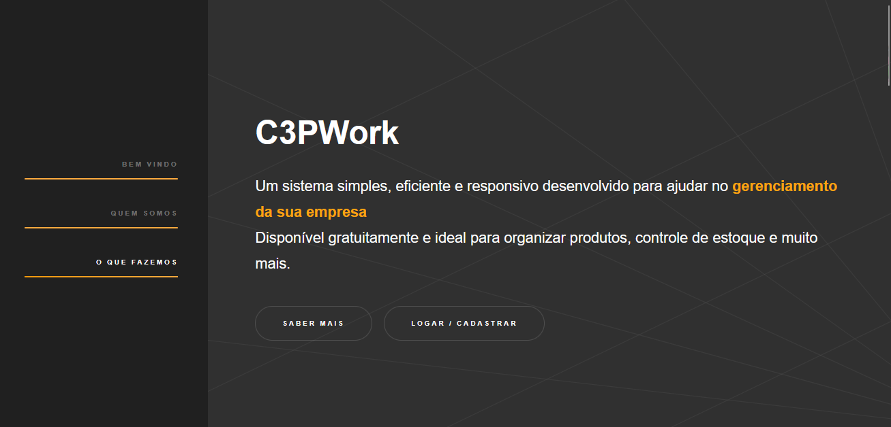
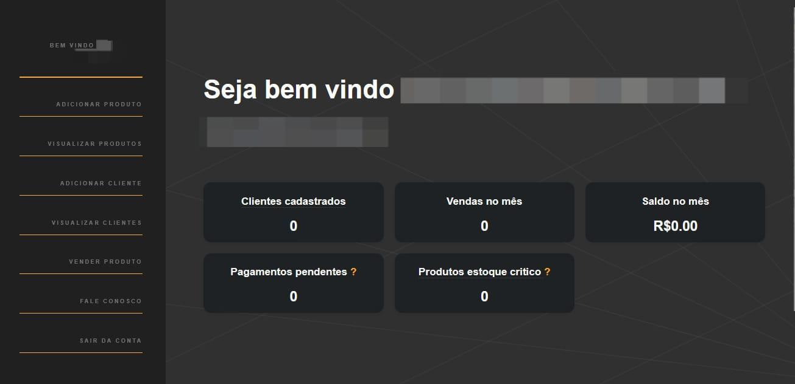
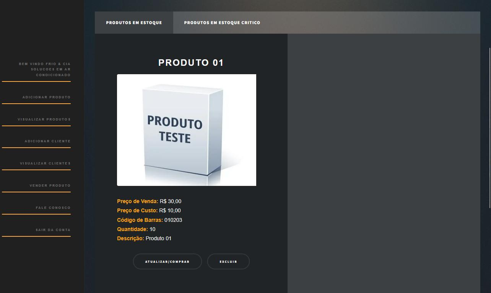
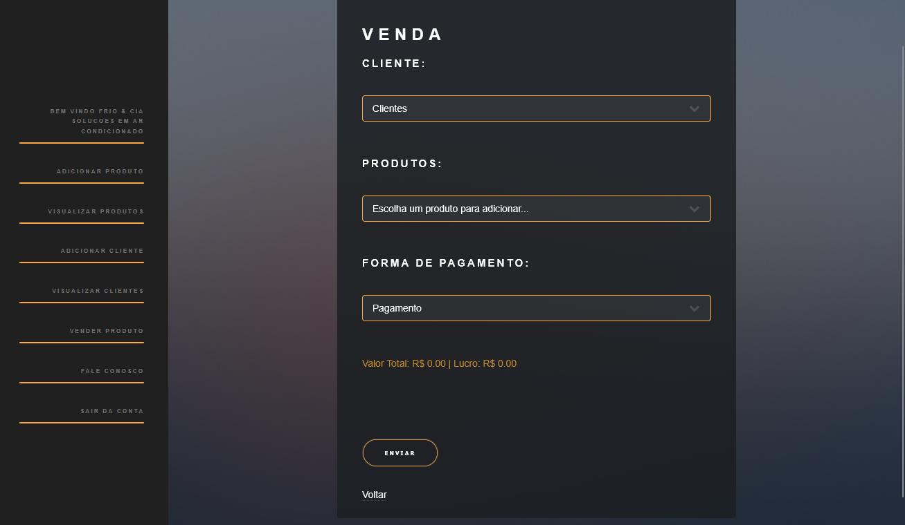
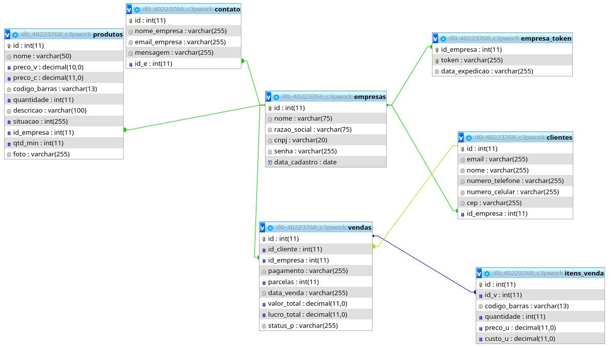

<div align="center">

# C3PWork

### Sistema de gerenciamento empresarial para pequenos e médios negócios

Clientes, estoque e vendas num só lugar, com uma interface simples.


**Trabalho de Conclusão de Curso · Técnico Integrado em Informática · IFSP Araraquara · 2025**

[📄 Ler a documentação completa (PDF)](docs/documentacao-c3pwork.pdf)



</div>

---

## 📌 Sobre o projeto

O **C3PWork** é uma aplicação web de gestão empresarial, um ERP enxuto, criada para ajudar empreendedores de pequeno e médio porte a organizar **clientes, produtos, estoque e vendas**.

A maioria dos ERPs do mercado é complexa e exige grandes mudanças nos processos internos da empresa. O C3PWork faz o contrário: entrega o essencial do dia a dia de forma direta e fácil de usar.

Os requisitos vieram de uma **semana de observação numa empresa de ar-condicionado** e de entrevistas com o dono e com um vendedor. O protótipo depois foi **testado por 81 alunos** do IFSP Araraquara.

## ✨ Funcionalidades

| Módulo | O que faz |
| --- | --- |
| 🏢 **Empresas** | Cadastro e login pelo **CNPJ**, com consulta automática dos dados da empresa na API pública [CNPJá](https://cnpja.com) |
| 👥 **Clientes** | Cadastro e listagem de clientes da empresa, com validação de e-mail duplicado |
| 📦 **Produtos** | Cadastro com preço de custo, preço de venda, código de barras, quantidade e estoque mínimo. Também dá para editar e excluir |
| ⚠️ **Estoque crítico** | Avisa quando um produto chega ao estoque mínimo ou acaba, e o marca como inativo |
| 💰 **Vendas** | Registro de vendas com cliente, produtos, forma de pagamento e parcelas. Calcula **valor total e lucro** e dá baixa no estoque na hora |
| 📊 **Painel** | Mostra clientes cadastrados, vendas no mês, saldo, pagamentos pendentes e produtos em estoque crítico |
| ✉️ **Fale conosco** | Formulário de contato para suporte |

## 🖼️ Telas

<table>
  <tr>
    <td align="center"><b>Painel pós-login</b><br></td>
    <td align="center"><b>Produtos em estoque</b><br></td>
  </tr>
  <tr>
    <td align="center"><b>Registro de venda</b><br></td>
    <td align="center"><b>Modelo relacional</b><br></td>
  </tr>
</table>

## 🛠️ Tecnologias

- **Back-end:** PHP 8 (mysqli com *prepared statements*)
- **Front-end:** HTML5, CSS3 e JavaScript (Fetch API), com templates [HTML5 UP](https://html5up.net)
- **Banco de dados:** MySQL / MariaDB
- **Autenticação:** senhas com `password_hash` (bcrypt) e sessão por token aleatório guardado em cookie

## 🏗️ Arquitetura

As páginas PHP montam a interface. Os formulários são enviados por JavaScript (`fetch`) para pequenos *web services* em `ws/`, que respondem em JSON.

```
Navegador ──(fetch / FormData)──▶ ws/*.php ──▶ inc/funcoes.php ──▶ MySQL
    ▲                                  │
    └──────────── JSON ◀───────────────┘
```

```
c3pwork/
├── index.php, produtos.php, venda.php, ...   # páginas do sistema
├── empresa.html                              # login / cadastro de empresas
├── inc/            # conexão com o banco, funções e menus
├── ws/             # endpoints que respondem em JSON
├── assets/         # CSS e scripts próprios
├── bootstrap/      # templates, fontes e imagens
├── scripts/        # c3pwork.sql (estrutura do banco)
└── docs/           # documentação do TCC e imagens
```

### Banco de dados

| Tabela | Descrição |
| --- | --- |
| `empresas` | Usuários do sistema (nome, razão social, CNPJ, senha) |
| `empresa_token` | Tokens de sessão de cada empresa |
| `clientes` | Clientes de cada empresa |
| `produtos` | Produtos, preços, código de barras e estoque |
| `vendas` | Vendas registradas (cliente, produto, quantidade, pagamento, parcelas, data) |

## 🚀 Como executar

**Requisitos:** PHP 8+ e MySQL/MariaDB. A forma mais simples é usar o [XAMPP](https://www.apachefriends.org).

1. Clone o repositório dentro da pasta do servidor (ex.: `C:\xampp\htdocs` ou `/opt/lampp/htdocs`):
   ```bash
   git clone https://github.com/<seu-usuario>/c3pwork.git
   ```
2. Crie o banco `c3pwork` e importe a estrutura:
   ```bash
   mysql -u root -e "CREATE DATABASE c3pwork CHARACTER SET utf8mb4;"
   mysql -u root c3pwork < c3pwork/scripts/c3pwork.sql
   ```
   (ou importe `scripts/c3pwork.sql` pelo phpMyAdmin)
3. Se precisar, ajuste as credenciais do banco em [`inc/funcoes.php`](inc/funcoes.php) (padrão: `root`, sem senha, porta `3306`).
4. Abra **http://localhost/c3pwork/** e cadastre sua empresa em *Logar / Cadastrar*.

## 🧪 Avaliação com usuários

O sistema foi testado por **81 alunos** do 2º e do 3º ano do Técnico Integrado em Informática do IFSP Araraquara. Eles avaliaram cada tela por formulário:

| Tela / recurso | Muito bom | Bom |
| --- | :---: | :---: |
| Página inicial | **91,4%** | 8,6% |
| Cadastro de usuário | **76,5%** | 18,5% |
| Logout | **72,8%** | 18,5% |
| Adicionar produtos | **71,6%** | 18,5% |
| Vendas | **70,4%** | 19,8% |
| Exclusão de produtos | **69,1%** | 23,5% |
| Login | **65,4%** | 22,2% |
| Adicionar clientes | **60,5%** | 30,9% |
| Exibição de produtos | **60,5%** | 24,7% |
| Edição de clientes | **55,6%** | 30,9% |
| Aviso de estoque baixo | **53,1%** | 27,2% |

Os detalhes da metodologia, dos requisitos e dos resultados estão na [documentação completa](docs/documentacao-c3pwork.pdf).

## 👥 Autores

- **Ana Clara Barroti Moreno**
- **Felipe Valentin Bassetti**
- **Kauê Filipe Nascimento de Oliveira**

**Orientador:** Prof. Francisco Rocha Pirolla

Instituto Federal de Educação, Ciência e Tecnologia de São Paulo, *campus* Araraquara, 2025.
